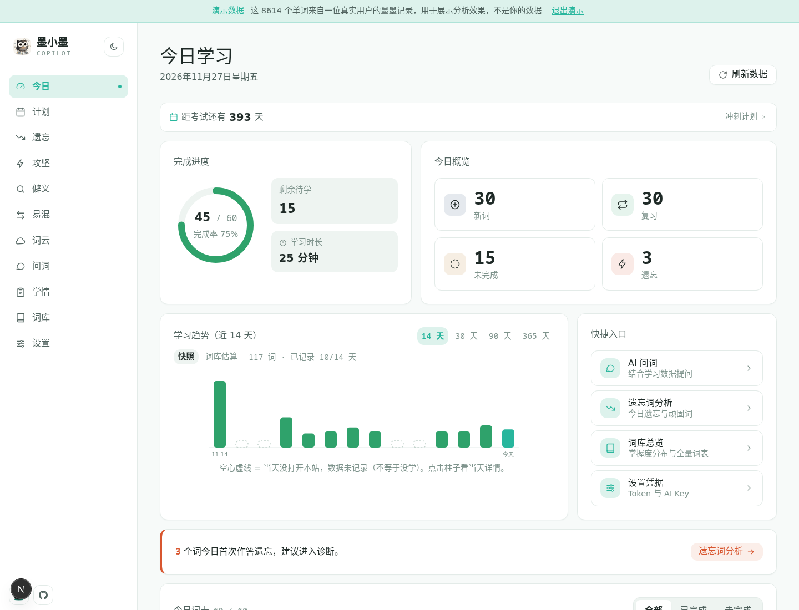
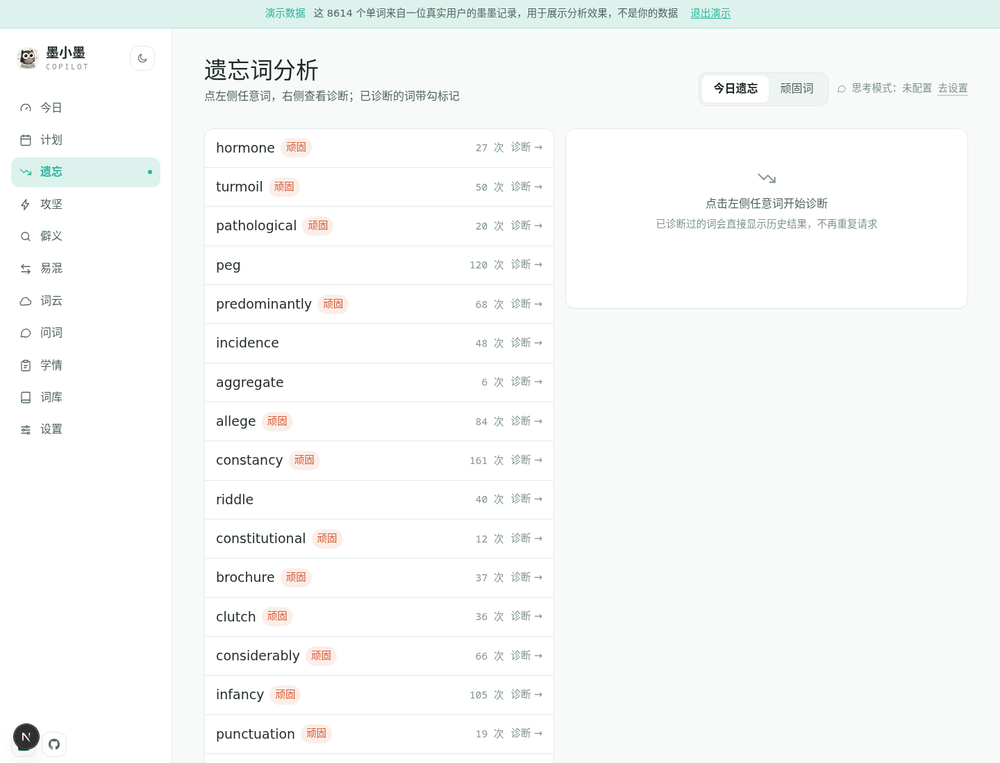
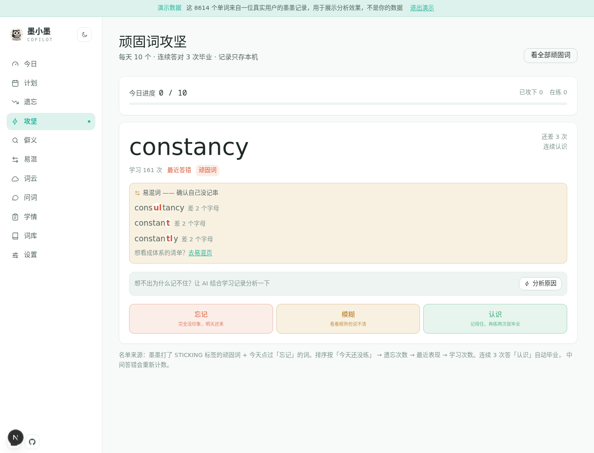
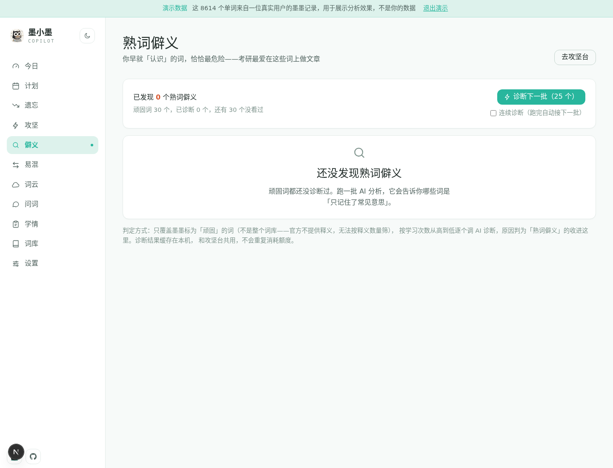
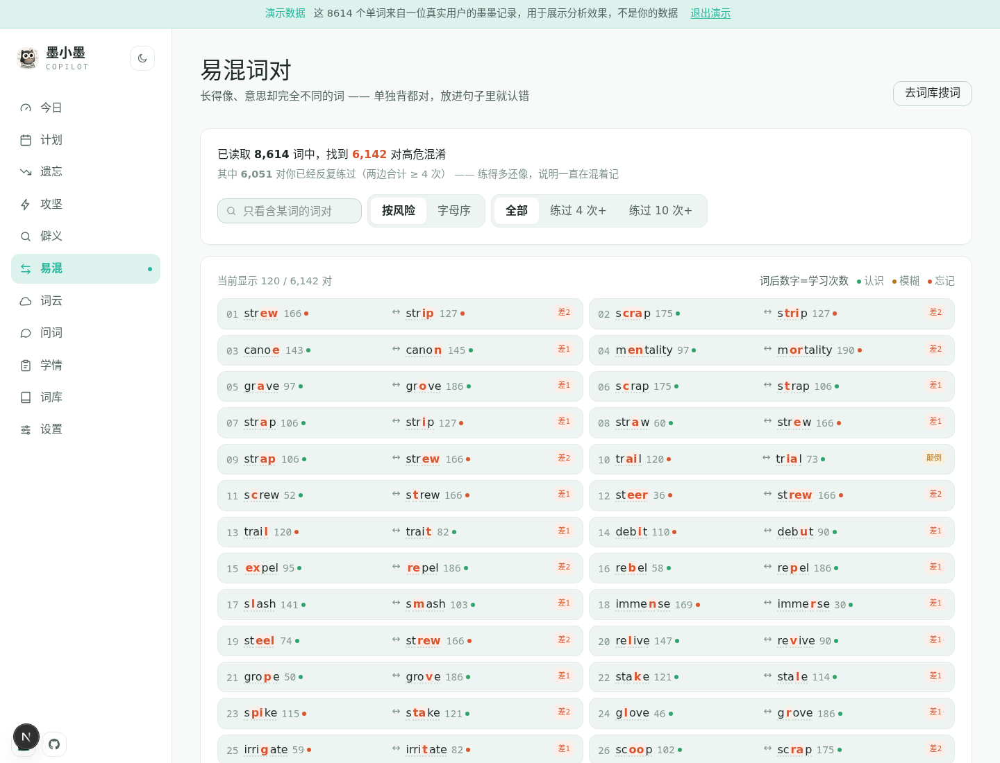
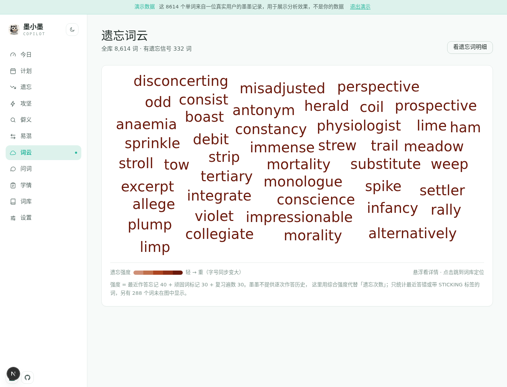
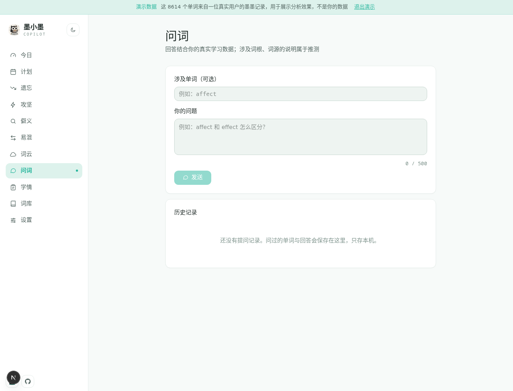
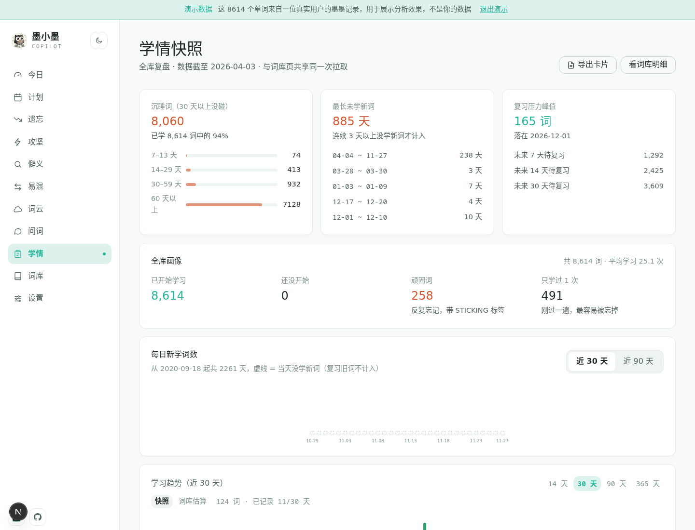
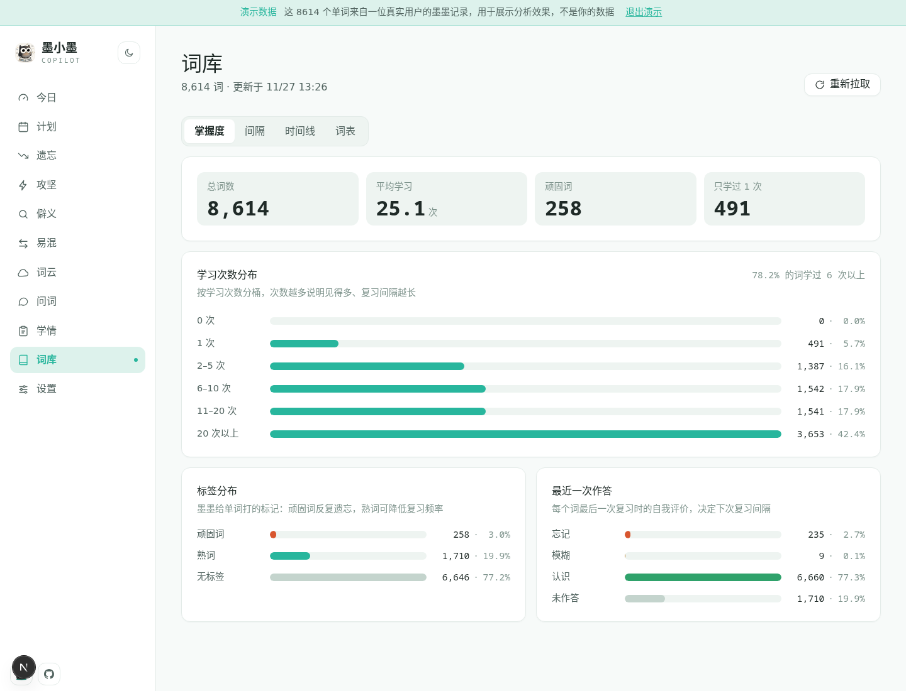
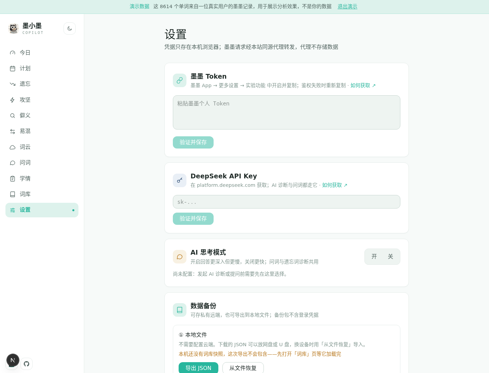

<div align="center">

# 墨小墨

**把墨墨背单词的复习数据，拆成看得懂的风险和下一步**

纯前端 · 无需后端 · 数据只存在你自己的浏览器里

</div>

---

## 这是什么

墨墨背单词会告诉你「今天该背哪些词」，但不会告诉你：

- 考前那两周的复习量会不会爆
- 一个背了 190 遍的词，为什么间隔还是 4 天
- 词库里有多少词已经沉睡半年
- 按现在的速度，考前到底背不背得完

墨小墨不替代墨墨，它**坐在旁边帮你看数据**：读墨墨开放的复习记录，算出风险、找出顽固词、给出具体的下一步。

所有数字都由代码计算，可以直接和墨墨 App 对照核对；AI 只负责把数字翻译成人话，不参与算术。

想先看看效果？打开站点后点「**看看演示**」，会用一份真实的 8,614 词记录填充全部页面，不需要 Token。

## 功能

> 以下截图全部来自**演示模式**——一份 8,614 词的真实学习记录，不是测试数据。页面顶部的横条就是演示模式标记，点「退出演示」即可恢复成你自己的数据。

### 今日 · 今天该关心什么



打开就是今天的状态，不用点第二下。

- **进度环**：完成数 / 今日计划，右侧是剩余待学与学习时长
- **四分项**：新词、复习、未完成、遗忘，各占一格
- **今日词表**：逐个词标出「新/复习」「已完成/未完成」「首次作答结果」
- **完成趋势**：14 / 30 / 90 / 365 天可切，点柱子看某天的明细

趋势有两个数据源，因为口径不同所以做成互斥开关：

| 数据源 | 覆盖范围 | 含义 |
|---|---|---|
| 快照 | 只有打开过本站的日子 | 当天真实完成数 |
| 词库估算 | 回溯到最早背词那天 | 新学 + 复习（复习量是下界）|

### 计划 · 考前背不背得完


墨墨只给一个笼统的「未来待复习量」。这里把每个词的 `next_study_date` 逐日摊开，画成日历：

- **负荷日历**：未来 30 / 60 / 90 天，颜色越暖代表那天要复习的越多
- **分档用窗口内的相对分位**，不是写死阈值——词库从几十到几百都有，绝对阈值会让小词库永远一片浅色
- **峰值日自动选中**，如果峰值落在考前 7 天内，会单独红字警告
- **考前推演**：算出「每天需新学 N 个 vs 近期实际 M 个」的缺口，以及按当前速度的预计完成日

### 遗忘 · 今天错在哪



两批词分开列：今天点过「忘记」的、带 `STICKING` 标签的顽固词。

- 点左侧任意词，右侧看诊断；已诊断的带勾标记
- 每个词可以调一次 **AI 诊断**：为什么老忘、是词形混淆还是义项太多、下次怎么记
- 诊断结果按词缓存，不重复消耗额度
- 诊断出的建议可以**一键写进墨墨助记**，手机上打开 App 就能看到——这是全站唯一会改动你墨墨数据的操作，写前二次确认，写完存下 note id 随时能撤回

### 攻坚 · 每天练 10 个



遗忘页只能把顽固词摆出来，看完就结束了。攻坚台把「练」这一环补上：

- 每天挑 **10 个**：今天已答对的让位给还没搞定的，遗忘次数多的优先
- 三键自测：**认识 / 模糊 / 忘记**，连续 3 次「认识」才从名单里消失
- **毕业不是永久判决**：连对 3 次后冷却 30 天，到期自动回到候选池复查——三次点击只是弱信号，一个词几个月后忘了很正常
- 优先查学习次数多的词：学了很多遍还记不住，最可能是只记住了常见义
- 训练记录只存本机，不会改变墨墨的复习安排

### 僻义 · 熟词僻义雷达



「认识每个词，但读不懂句子」通常是因为只知道常见义。墨墨不提供释义数据，所以这里从 AI 诊断结果里筛 `RARE_SENSE` 枚举：

- 按批挖掘，每批挑若干顽固词请 AI 判断「是否有更冷门但常考的意思」
- 结果按可信度排序，可以逐个看 AI 的解释
- 只覆盖被诊断过的词，不是全库扫描

### 易混 · 长得像但意思不同



「单独背都对，放进句子里就认错」是最隐蔽的失分点，而墨墨不提供「混淆词」这个概念。这里纯前端做拼写比对，三类信号一起看：

- **差 1–2 个字母**：`affect` / `effect`、`desert` / `dessert`
- **字母相同、顺序不同**：`quiet` / `quite`、`form` / `from` —— Levenshtein 判不出（距离为 2），必须单独用变位距离
- **词干延伸**：`economic` / `economical`

为了让 8,000 词两两比较不卡住页面，用变位签名 + 首字母/长度分桶 + 删字签名三组预索引把候选量压下来。排序把「两边都练过很多遍」的组合提前——练得多还混，才是真的危险。

同一个算法也接进了词库搜索：输入拼不准的 `efect` 也能找到 `effect`，差异字母标红。

### 词云 · 哪些词最危险



按遗忘强度排布的词云：字号越大、颜色越深，说明这个词越值得优先处理。

排布算法是确定性的（同一批数据每次画出同样的图），不是随机撒点——这样你隔一周回来看，能直观对比「上次那几个大字还在不在」。

### 问词 · 就某个词问 AI



输入单词和问题，AI 结合你的真实学习数据回答——它知道这个词你背了几次、上次答对还是答错、间隔多长。

- 回答以流式逐字出现，可以中途停止
- **深度思考开关**：关掉更快更省，打开会多花几秒但推理更细
- 问完的记录存在本机，可展开回看、重新提问、删除单条、一键清空
- 最多保留 100 条

### 学情 · 全库复盘



把整个词库摊开看，五个区块：

- **沉睡词**：距上次学习 30 天以上，按 7–13 / 14–29 / 30–59 / 60+ 分桶
- **未学新词区间**：连续 3 天以上没有「第一次学某个词」的日期段（复习旧词不计入）
- **词汇量增长**：按月累计「真正学过的词数」，柱状是当月新增。用的是首次学习日而不是加入日期——一次导入 3,000 词但没碰过，不该算进词汇量
- **学习趋势**：与今日页同一个组件，默认 30 天窗口
- **学习热力图**：365 天格子，有快照的日子用真实完成数，没快照的日子按「首次学习 + 最后一次学习」估算

右上角可以**导出卡片**（一张包含核心指标的图片）和请 AI 写一段解读。

### 词库 · 八千词摊开看



四个视图共用同一次全量拉取，切换零请求：

| 视图 | 看什么 |
|---|---|
| 掌握度 | 学习次数分布、标签构成、作答构成 |
| 间隔 | 复习间隔分布 + **间隔停滞词** |
| 时间线 | 按月看「加入词库」与「首次学习」的差额 |
| 词表 | 全部 9 个字段逐行浏览，支持搜索/筛选/排序/分页 |

**「间隔」视图是这里最特别的一块**。间隔 = 下次复习日 − 上次学习日，是墨墨对这个词记牢程度的直接判断。据此能筛出「**间隔停滞**」的词：

> 背了 5 次以上，间隔仍不超过 7 天

这批词不会出现在遗忘页——它们的最近一次作答可能恰好是「认识」，从任何常规指标看都正常。但它们其实一直在「刚背完 → 又忘」的循环里。演示数据里有 86 个这样的词，最狠的背了 190 次、间隔 4 天。

### 设置 · 凭据与备份



- **墨墨 Token**：粘贴即生效，页面里附了获取步骤的图文指引
- **DeepSeek API Key**：BYOK。保存前会先探测有效性，失败不覆盖旧 Key；只回显末四位
- **AI 余额**：实时查 DeepSeek 账户余额，不足时红字提示，旁边有充值入口
- **深度思考**：默认关闭，可在问词和学情解读时逐次切换
- **本地备份**：一键导出 JSON，或从文件恢复（带「远端 vs 本机」对照表）
- **云端备份**：GitHub / Gitee / WebDAV 三选一，一次只启用一个

## 数据与隐私

- **Token 和 AI Key 只存在 `localStorage`**，每次请求现取，不上传、不入日志
- 墨墨请求经同源边缘函数转发（浏览器直连会被它的 CORS 策略拦掉），代理只加一个 `Authorization` 头，不落地、不打日志
- 学习快照、攻坚记录、诊断缓存、问词历史全部只在本机
- 备份包不含任何凭据——换设备重贴一次即可
- 唯一的写操作是「写入墨墨助记」，可以在页面上撤回

## 快速开始

需要 Node 24+ 和 pnpm 9+。

```bash
pnpm install
pnpm dev        # http://localhost:3100
```

首次打开会引导配置两样东西：

1. **墨墨 Token** —— [墨墨开放平台](https://open.maimemo.com/)申请，并在墨墨 App 里开启「实验功能 → 数据同步」
2. **DeepSeek API Key** —— 用于 AI 诊断与解读（不配也能用，只是 AI 相关功能会提示未配置）

> 本地 `pnpm dev` 不带边缘函数，`/api/memo/*` 会 404 —— 除设置页外其余页面都会提示接口不可用。完整联调需要在 EdgeOne Pages 环境里跑。想仅预览界面，用 `?demo=1` 打开展示模式。

## 技术栈

| 层 | 选型 |
|---|---|
| 前端 | Next.js 16（App Router，静态导出）、React 19 |
| 样式 | Tailwind CSS v4，自定义 token 支持浅色 / 夜间切换 |
| 数据获取 | TanStack Query v5（全站共享同一次拉取） |
| 校验 | Zod |
| 墨墨 SDK | 自研 `packages/maimemo`，含滑动窗口限流、区间二分分页、断点续传 |
| AI | DeepSeek `deepseek-flash` |
| 存储 | IndexedDB（词库 8,000+ 条）+ localStorage（设置与快照）|
| 备份 | 本地 JSON + GitHub / Gitee / WebDAV |
| 部署 | EdgeOne Pages + Edge Functions |

### 项目结构

```
apps/web            前端：页面、组件、纯函数分析层
packages/maimemo    墨墨 Open API SDK
packages/ai         AI 任务：遗忘诊断、学情解读、词卡、问词
packages/types      跨包共享类型
edge-functions      边缘代理：绕过墨墨对浏览器跨域请求的限制
docs                截图与配图
```

## 致谢

数据来自 [墨墨背单词开放平台](https://open.maimemo.com/)；本项目与墨墨官方无关，是它的一个第三方数据看板。
