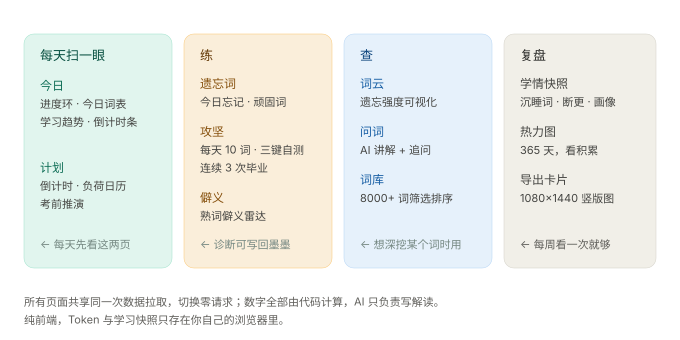
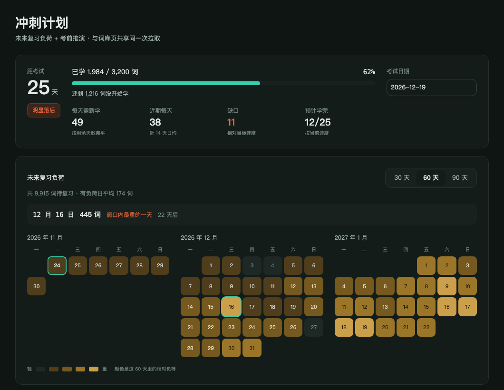
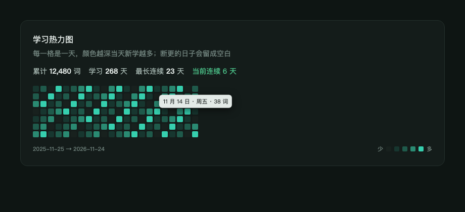

<div align="center">



# 墨小墨

**AI 背词副驾 —— 把墨墨背单词的复习数据，拆成看得懂的风险和下一步**

纯前端 · 无需后端 · 数据只存在你自己的浏览器里

</div>

---

## 这是什么

墨墨背单词会告诉你「今天该背哪些词」，但不会告诉你：

- 考前那两周的复习量会不会爆
- 一个已经背了 12 遍的词，为什么还是记不住
- 词库里有几个词已经沉睡超过 30 天
- 按现在的速度，考前到底背不背得完

墨小墨不替代墨墨，而是**坐在旁边帮你看数据**：读它开放的复习记录，算出风险、找出顽固词、给出具体的下一步。

所有数字都由代码计算，可以直接和墨墨 APP 对照核对；AI 只负责把数字翻译成人话，不参与算术。

## 截图

<table>
<tr>
<td width="50%"></td>
<td width="50%"></td>
</tr>
<tr>
<td><b>冲刺计划</b><br>未来 60 天的复习负荷日历 + 考前推演。颜色越暖代表那天要复习的越多，峰值日自动选中。</td>
<td><b>顽固词攻坚</b><br>每天 10 个最该练的词，AI 诊断「为什么老忘」，三个键自测，连续 3 次认识就毕业。</td>
</tr>
<tr>
<td></td>
<td></td>
</tr>
<tr>
<td><b>学习热力图</b><br>365 天的积累，鼠标扫过任意一格看当天学了多少。</td>
<td><b>设置</b><br>绑定墨墨 Token 与 AI Key，两者都只存在本机。左侧是完整的十一个页面。</td>
</tr>
</table>

## 功能一览

| 页面 | 路径 | 一句话 |
|---|---|---|
| 今日 | `/` | 进度环、今日词表、14 天趋势，顶部一条考试倒计时 |
| 计划 | `/plan` | 未来 30/60/90 天的复习负荷日历；考前推演算缺口与预计完成日 |
| 遗忘词 | `/forget` | 今天点过「忘记」的词 + 带 STICKING 标签的顽固词，可逐个 AI 诊断 |
| 攻坚 | `/drill` | 每天 10 个最该练的词，三键自测，连续 3 次认识毕业，30 天后回池复查 |
| 僻义 | `/rare` | 从诊断结果里筛出「熟词僻义」，支持按批挖掘 |
| 易混 | `/confusable` | 全库找出「长得像但意思不同」的词对，按风险排序 |
| 词云 | `/cloud` | 按遗忘强度排布的词云，一眼看出哪些词最危险 |
| 问词 | `/ask` | 就某个词向 AI 提问，问答记录存在本机、可回看 |
| 学情 | `/report` | 沉睡词、未学新词区间、全库画像、日曲线、热力图、导出卡片、AI 解读 |
| 词库 | `/library` | 全库词表，按掌握度 / 标签 / 时间筛选排序，支持相似词搜索 |
| 设置 | `/settings` | 绑定墨墨 Token 与 AI Key、查看 AI 余额、本地与云端备份、配置指引 |

### 几个值得单独说的

**未来复习负荷**

墨墨只给一个笼统的「未来待复习量」。这里把每个词的 `next_study_date` 逐日摊开，画成一张日历：

- 分档用**窗口内的相对分位**，不是写死阈值——词库从每天几十到几百都有，绝对阈值会让小词库永远一片浅色、大词库永远爆红
- 峰值日自动选中，并和考试日期联动：如果峰值落在考前 7 天内，会单独红字警告「那几天还得复习这么多」
- 同时算出「每天需新学 N 个 vs 近期实际 M 个」的缺口，以及按当前速度的预计完成日

**顽固词攻坚**

`/forget` 和 `/cloud` 只能把顽固词摆出来，看完就结束了。攻坚台把「练」这一环补上：

- 每天挑 10 个：今天已答对的让位给还没搞定的，遗忘次数多的优先
- 每个词可以调一次 AI 诊断（结果按词缓存，不重复消耗额度）
- 三键自测：认识 / 模糊 / 忘记，连续 3 次「认识」才从名单里消失
- **毕业不是永久判决**：连对 3 次后冷却 30 天，到期重新回到候选池复查——三次点击只是弱信号，考研周期十几个月，一个词几个月后忘了很正常。复查答对继续毕业，答错就回到正常训练
- 优先查学习次数多的词：学了很多遍还记不住，最可能是「只记住了常见义」
- 训练记录只存本机——墨墨没有回写复习结果的接口，这里练得再好也不会改变它的复习安排，页面上写明了这点

**写回墨墨**

诊断出的建议，可以一键写进墨墨的助记，手机上打开 APP 就能看到。这是全站**唯一**会改动你墨墨数据的操作，所以做了三层约束：只写助记不动其他、写前二次确认、写完存下 note id 随时能撤回。

**易混词对**

「单独背都对，放进句子里就认错」是最隐蔽的失分点，而墨墨不提供「混淆词」这个概念。这里纯前端做拼写比对，三类信号一起看：

- **差 1–2 个字母**：`affect` / `effect`、`desert` / `dessert`
- **字母相同、顺序不同**：`quiet` / `quite`、`form` / `from` —— 这类 Levenshtein 判不出（距离为 2），必须单独用变位距离
- **词干延伸**：`economic` / `economical`

为了不让 8000 词两两比较卡住页面，用变位签名 + 首字母/长度分桶 + 删字签名三组预索引，把候选量压下来（实测几毫秒）。排序把「两边都练过很多遍」的组合提前——练得多还混，才是真的危险。

同一个算法也接进了词库搜索：搜索框旁的**「相似词」**开关，输入拼不准的 `efect` 也能找到 `effect`，差异字母直接标红。

## 技术栈

| 层 | 选型 |
|---|---|
| 前端 | Next.js 16（App Router，静态导出）、React 19 |
| 样式 | Tailwind CSS v4，自定义 token 支持浅色 / 夜间切换 |
| 数据获取 | TanStack Query v5（全站共享同一次拉取） |
| 校验 | Zod |
| 墨墨 SDK | 自研 `packages/maimemo`，含限流、错误映射、三策略兜底分页 |
| AI | DeepSeek `deepseek-flash`（遗忘诊断 / 学情解读 / 词卡 / 问词） |
| 备份 | 本地 JSON 导出导入 + GitHub / Gitee / WebDAV |
| 统计 | 微软 Clarity + Google Tag Manager（仅生产构建注入） |
| 部署 | EdgeOne Pages + Edge Functions（代理墨墨接口） |

### 项目结构

```
apps/web            前端：页面、组件、纯函数分析层
packages/maimemo    墨墨 Open API SDK
packages/ai         AI 任务：遗忘诊断、学情解读、问词
packages/types      跨包共享类型
edge-functions      边缘代理：绕过墨墨对浏览器跨域请求的限制
docs                配图
```

**为什么需要边缘代理**：墨墨 `open.maimemo.com` 对带 `Origin` 头的请求一律返回 403，浏览器无法直连。边缘函数以服务端身份转发，只为请求加一个 `Authorization` 头，不落地 Token、不打日志。

## 备份与恢复

学习痕迹大多只存在本机，所以提供了两条互不依赖的备份通道。

**① 导出到本地文件**（不需要任何配置）

设置页一键下载 `momoxiao-backup-<时间戳>.json`。适合定期存网盘或 U 盘，换设备时用「从文件恢复」导入。

**② 云端备份**（GitHub / Gitee / WebDAV 三选一）

配置一次后，点「立即备份」把同一个包传到你的私有仓库或网盘。三种方式一次只启用一个。

**备份包内容**：诊断历史、AI 词卡缓存、顽固词攻坚记录、词库学习快照、每日学习快照、思考模式与考试日期。

**不含**墨墨 Token 与 DeepSeek Key —— 换设备重贴一次即可，避免明文凭据上云。

**恢复是增量的**，除词库快照外其余都按时间合并，不会把本机更新的记录覆盖掉：

| 数据 | 冲突时 |
|---|---|
| 诊断历史 / 词卡 | 取更新时间较新的一条 |
| 攻坚记录 | 按词取「最近一次作答」更新的一方（不逐条拼，避免打乱「连续 3 次」的判断）；助记的 `noteId` 例外，本机有就保留 |
| 每日快照 | 同一天取采集时间较晚的，其他日期只增不删 |
| 词库快照 | 仅当远端更新时间较新才覆盖，且本机更全时保留本机 |
| 思考模式 / 考试日期 | 本机已配置则不动 |

恢复前会先弹「远端 vs 本机」对照表，确认后才动数据。

> 云端备份每次覆盖同一个文件。GitHub / Gitee 还能靠 commit 历史翻回去，**WebDAV 多数服务不留版本，覆盖即永久丢失**——建议定期额外导出一份本地文件。

## 快速开始

需要 Node 24+ 和 pnpm 9+（与 `package.json` 的 engines 一致）。

```bash
pnpm install
pnpm dev        # http://localhost:3100
```

首次打开会引导你去设置页配置两样东西：

1. **墨墨 Token** —— 在[墨墨开放平台](https://open.maimemo.com/)申请，并在墨墨 APP 里开启「实验功能 → 数据同步」
2. **DeepSeek API Key** —— 用于 AI 诊断与解读（不配也能用，只是 AI 相关功能会提示未配置）

> 本地 `pnpm dev` 不带边缘函数，`/api/memo/*` 会 404 —— 除设置页外，其余页面都会提示接口不可用。完整联调需要在 EdgeOne Pages 环境里跑（或本地用 EdgeOne CLI 起边缘函数）。

## 版本号

`apps/web/package.json` 的 `version` 是唯一真相源，构建时注入 `NEXT_PUBLIC_APP_VERSION` 与 commit 短 SHA，显示在侧栏底部，方便线上核对代码版本。

按**交付批次** bump，不按提交数：一次功能做完、或一批修复告一段落才动一次；同一模块的连续微调只在最后那次 bump；纯内部重构不 bump。

## 数据与隐私

- **Token 和 AI Key 只存在 `localStorage`**，每次请求现取，不上传、不入日志
- 边缘函数只做请求转发，不存储任何数据
- 学习快照（每日完成数）、攻坚训练记录、诊断缓存、问词历史也都存在本机
- 备份包同样不含任何凭据
- 换设备或清缓存 = 重新配置，没有云端账户
- 唯一的写操作是「写入墨墨助记」，可以在页面上撤回
- 线上站点接了微软 Clarity 与 Google Tag Manager 做匿名访问统计。**Clarity 必须开启 Mask all text**，否则录屏会记录页面上的词库与诊断内容；本地开发环境不加载这两个脚本

## 已知限制

- **全量拉取首次约 80 秒**：`query_study_records` 单次最多返回 1000 条，8,600 多个词要靠 `next_study_date` 区间递归二分才能拉全（实测 55 个请求、79.9 秒）。受墨墨「40 次 / 60 秒」频控约束，中途会排队约 35 秒，词库页会显示「等待频控 Ns」而不是干等。另有 1 个词没有排期日期，日期区间扫不到，靠一次无日期兜底查询补齐。之后走缓存：6 小时内直读，6–24 小时只花 1 个请求校验总数；手动「重新拉取」才会重跑全量，中断后可从断点续传
- **官方释义不开放**：`vocabulary` 接口只返回 `id` 和 `spelling`，所以「熟词僻义」不能按释义数量筛，改用 AI 诊断的 `RARE_SENSE` 枚举推断
- **没有逐日复习记录**：墨墨只给「首次学习日期」，所以热力图的复习量依赖本地快照——只在打开过本站的日子准确；「新学」与「未学新词」两个指标只统计词首次学习，复习旧词不计入
- **问词是单轮**：每次提问独立，不携带上一轮上下文（`buildAskMessages` 预留了 `history` 参数，UI 还没接）
- **学习数据是公测接口**：当天没在 APP 里初始化，个别数字可能不准
- **AI 诊断是推测**：结论措辞都留了余地，别把它当定论
- **国内网络下 GTM 不可达**：`googletagmanager.com` 多数情况连不上，脚本静默失败、不影响页面，但也基本收不到数据

## 致谢

数据来自[墨墨背单词开放平台](https://open.maimemo.com/)；本项目与墨墨官方无关，只是它的一个第三方数据看板。
