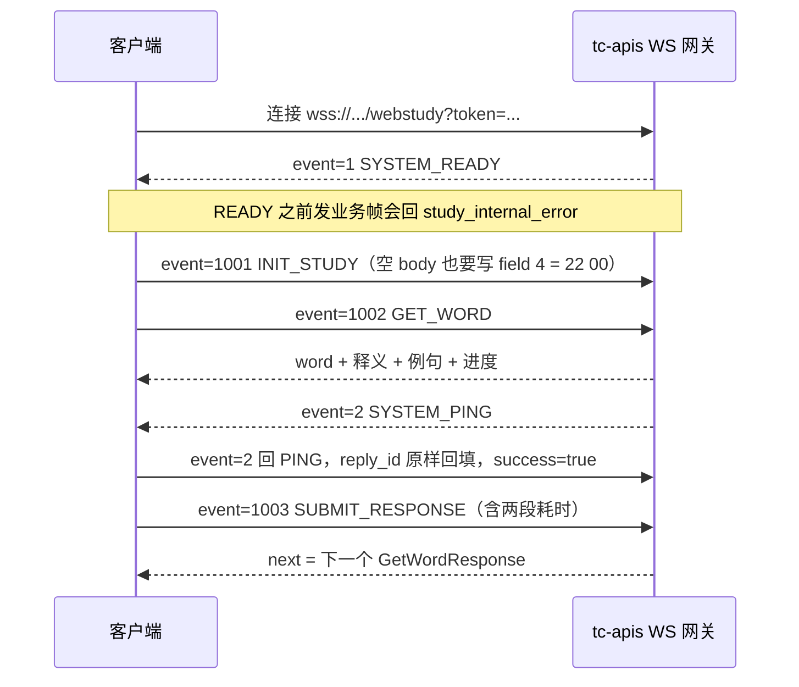

# 墨墨网页版接口逆向调研

> 调研日期：2026-11-25
> 起因：网页版 `/home/web_study` 有读音、例句、单词释义，但官方 Open API 不提供这些信息，评估能否逆向出接口并接入墨小墨词卡。
> 本文档只做技术调研与方案评估，**不改代码、不接入私有协议**。

---

## 0. 结论速览

**能逆向，而且已经有人把协议完整逆出来并开源了。但不建议为这三类字段接入墨小墨。**

最致命的原因不是技术难度，而是**私有协议不能按单词任意查询**：`GET_WORD` 请求只有一个 `back: bool`，服务端按「今日学习队列」顺序推词，无法指定 `spelling`。而墨小墨的词卡是 8000+ 全库任意点开一个词就要出释义，两者架构不匹配。

| 目标字段 | 官方 Open API | 网页版私有 WS | 公开方案 |
|---|---|---|---|
| 单词释义 | ❌ 只有 `id` / `spelling` | ✅ 官方词库释义 `field 2` | ✅ 公开词典 / DeepSeek |
| 音标（美 / 英） | ❌ | ✅ `phonetic_us` / `phonetic_uk` / `hyphenation` | ✅ 公开词典 / DeepSeek |
| 例句 | ❌ `phrases` 是用户自建 CRUD | ✅ `field 3`（结构未完全还原） | ✅ 公开词典 / DeepSeek |
| 助记 | ❌ `notes` 是用户自建 CRUD | ✅ `field 4`（结构未完全还原） | 部分可得 |
| 发音音频 | ❌ | ❌ 协议内无音频 URL，另走 CDN | ✅ 有道 dictvoice（已实测） |
| 按拼写任意查词 | ✅ | ❌ 只能按队列顺序 | ✅ |
| 需要额外凭据 | Token（项目已用） | `ws_token`（与开放平台 Token 不通用） | 无 |

---

## 1. 调研方法与证据来源

| 步骤 | 做法 | 结果 |
|---|---|---|
| 网页版页面 | `curl https://www.maimemo.com/home/web_study` | HTTP 302 → `/home/login?continue=home/web_study`，确认需登录会话；落地页只引用 `public.min.js` / `memo.min.js` / `auth.min.js`，无学习页业务代码 |
| 官方能力清单 | 抓 `https://www.maimemo.com/pages/openapi-demo/` 的 Vite bundle，从 `assets/operations-*.js` 解析全部 operation 定义 | 精确得到 34 个接口及其 request/response schema |
| 私有协议 | 核对开源项目 [MoFish](https://github.com/U2yyy/MoFish) 的 `maimemo.proto` 与 `momo_ws.py` | 得到 WS 地址、事件号、字段编号、握手与反作弊规则 |
| 路径验证 | 匿名请求若干 Open API 路径，按 401 / 404 区分「存在但需鉴权」与「不存在」 | 见 §2.4 |
| 发音验证 | `curl https://dict.youdao.com/dictvoice?audio=apple&type=2` | HTTP 200，`audio/mpeg`，9837 字节，有效 MP3 |
| 官方说明 | `https://www.maimemo.com/help30` | 音频为独立下载并本地缓存的压缩文件，不走学习数据通道 |

---

## 2. 官方 Open API 的真实能力边界

### 2.1 全部 34 个操作（按官方演示页分组）

Base：`https://open.maimemo.com/open`（官方 demo 的 client 配置）。项目 SDK 用的是 `https://open.maimemo.com/open/api/v1/memo`，见 §2.4。

| 分组 | 数量 | 操作 |
|---|---|---|
| 单词 | 2 | `GET /api/v1/vocabulary`、`POST /api/v1/vocabulary/query` |
| 释义 | 4 | `GET/POST /api/v1/interpretations`、`POST/DELETE /api/v1/interpretations/{id}` |
| 例句 | 4 | `GET/POST /api/v1/phrases`、`POST/DELETE /api/v1/phrases/{id}` |
| 助记 | 4 | `GET/POST /api/v1/notes`、`POST/DELETE /api/v1/notes/{id}` |
| 云词本 | 5 | `GET/POST /api/v1/notepads`、`GET/POST/DELETE /api/v1/notepads/{id}` |
| 学习数据（公测） | 5 | `get_study_progress`、`get_today_items`、`query_study_records`、`add_words`、`advance_study` |
| 记忆卡 | 10 | `/api/v1/markji/decks/*`、`/api/v1/markji/files/*` CRUD |

<details>
<summary>完整清单（34 条）</summary>

```text
 1  POST   /api/v1/interpretations                                 创建释义
 2  DELETE /api/v1/interpretations/{id}                            删除释义
 3  GET    /api/v1/interpretations                                 获取释义
 4  POST   /api/v1/interpretations/{id}                            更新释义
 5  POST   /api/v1/markji/decks/{deck}/chapters/{chapter}/cards    新建卡片
 6  GET    /api/v1/markji/decks/{deck}/cards/{card}                获取卡片
 7  GET    /api/v1/markji/decks/{deck}/chapters/{chapter}          获取指定章节
 8  GET    /api/v1/markji/decks/{deck}                             获取牌组信息
 9  GET    /api/v1/markji/decks/{deck}/chapters                    获取牌组章节
10  GET    /api/v1/markji/decks                                    获取我的牌组列表
11  GET    /api/v1/markji/decks/folders                            获取文件夹列表
12  POST   /api/v1/markji/files/query                              查询文件
13  POST   /api/v1/markji/decks/{deck_id}/cards/{card_id}          更新卡片
14  POST   /api/v1/markji/files                                    上传文件
15  POST   /api/v1/notepads                                        创建云词本
16  DELETE /api/v1/notepads/{id}                                   删除云词本
17  GET    /api/v1/notepads/{id}                                   获取云词本
18  GET    /api/v1/notepads                                        查询云词本
19  POST   /api/v1/notepads/{id}                                   更新云词本
20  POST   /api/v1/notes                                           创建助记
21  DELETE /api/v1/notes/{id}                                      删除助记
22  GET    /api/v1/notes                                           获取助记
23  POST   /api/v1/notes/{id}                                      更新助记
24  POST   /api/v1/phrases                                         创建例句
25  DELETE /api/v1/phrases/{id}                                    删除例句
26  GET    /api/v1/phrases                                         获取例句
27  POST   /api/v1/phrases/{id}                                    更新例句
28  POST   /api/v1/study/add_words                                 添加单词（公测）
29  POST   /api/v1/study/advance_study                             提前复习（公测）
30  POST   /api/v1/study/get_study_progress                        获取今日学习进度（公测）
31  POST   /api/v1/study/get_today_items                           获取今日学习单词（公测）
32  POST   /api/v1/study/query_study_records                       查询学习记录（公测）
33  GET    /api/v1/vocabulary                                      获取单词
34  POST   /api/v1/vocabulary/query                                查询单词
```

</details>

### 2.2 关键 schema（从 bundle 中原样提取）

```javascript
// VocabularyService.GetVocabulary
{
  method: 'get', path: '/api/v1/vocabulary',
  queryParams: [{ name: 'spelling', required: true, type: 'string' }],
  responseSchema: {
    properties: {
      voc: {
        properties: {
          id:       { type: 'string', example: '5a7BFf4F63612e5AD9fdebB7a50D3881' },
          spelling: { type: 'string', example: 'apple' }
        },
        required: ['id', 'spelling']
      }
    },
    required: ['voc']
  }
}

// VocabularyService.ListVocabulary
{
  method: 'post', path: '/api/v1/vocabulary/query',
  bodySchema: { spellings: string[<=1000], ids: string[<=1000] },
  responseSchema: { voc: Array<{ id, spelling }> }
}

// StudyService.GetTodayItems（公测）
today_items: Array<{
  voc_id, voc_spelling, order, first_response, is_new, is_finished
}>
```

三个「内容」分组（释义 / 例句 / 助记）都是 **CRUD 形态**：有 create / update / delete，说明它们是**用户自建资源**，不是官方词库的只读视图。开源项目 maimemo-desktop 的 README 也明确写：「MaiMemo interpretations return user-created definitions only; for accounts without them, the Youdao fallback is used (this is the normal case)」。

### 2.3 结论

- 项目 `README.md` 中「**官方释义不开放**：`vocabulary` 接口只返回 `id` 和 `spelling`」的判断**成立**，无需修改。
- 墨墨百科《开放 API 功能介绍》里「第三方工具可调取墨墨词库的单词释义、例句、助记内容」是**营销措辞**，实际指上述三组自建内容接口，不是官方词库内容。
- 全部 34 个接口里**没有任何** `phonetic` / `audio` / `pronunciation` / `sound` 字段（对 bundle 做过关键词扫描，命中数为 0）。
- 顺带发现：项目 SDK 目前只覆盖其中 10 个操作（单词 1、释义/例句/助记各 1 读、助记增删、云词本 1 读、学习数据 3 读）。未覆盖 `POST /vocabulary/query` 批量查词、`add_words` / `advance_study` 两个写接口，以及记忆卡 10 个接口。其中 `add_words` / `advance_study` 属写操作，与 README「全站唯一写操作是写入助记」的表述相关，**本次不改代码，仅记录**。

### 2.4 两个 base 前缀

| 请求 | 匿名响应 |
|---|---|
| `GET /open/api/v1/memo/vocabulary?spelling=apple` | 401 `common_unauthorized` |
| `GET /open/api/v1/vocabulary?spelling=apple` | 401 `common_unauthorized` |
| `POST /open/api/v1/memo/study/get_today_items` | 401 `common_unauthorized` |
| `POST /open/api/v1/study/get_today_items` | 401 `common_unauthorized` |
| `POST /open/api/v1/openapi.json` | 404 `common_not_found` |

两者都返回 401 而非 404，判断为**路由别名**（都能命中鉴权层）。无真实 Token，无法确认带凭据后返回是否完全等价。官方没有公开 `openapi.json` / `swagger.json`，演示页的 operation 定义是目前最完整的机器可读来源。

---

## 3. 网页版 `web_study` 私有协议

### 3.1 端点与鉴权

```text
wss://tc-apis.maimemo.com/study/ws/webstudy?token=<ws_token>
```

- `ws_token` 获取方式：浏览器登录 `www.maimemo.com` → 点「开始学习」→ DevTools / Network 里能看到明文 token。
- **与开放平台 Token 不通用**：开放平台 Token 只能调 REST，网页版 Token 只能连 WS。
- 学习页 HTML 需登录态才能拿到，未登录时 302 到登录页，因此无法静态获取其前端 bundle；以下协议定义来自开源逆向成果。

### 3.2 信封与事件

```protobuf
message WebsocketProtocolMessage {
  string id        = 1;   // 帧 ID
  string reply_id  = 2;   // 响应帧填对方请求的 id
  int32  event     = 3;
  bytes  data      = 4;   // 业务体（嵌套 protobuf）
  bool   success   = 5;
  repeated WebsocketProtocolError errors = 6;
}

enum WebsocketProtocolEvent {
  SYSTEM_READY             = 1;
  SYSTEM_PING              = 2;
  SYSTEM_SUBSCRIBE_TOPICS  = 3;
  WEBSTUDY_INIT_STUDY      = 1001;
  WEBSTUDY_GET_WORD        = 1002;
  WEBSTUDY_SUBMIT_RESPONSE = 1003;
}
```

### 3.3 取词响应的字段

```protobuf
message WebStudyWord {
  string id          = 1;  // UUID
  int32  voc_id      = 2;  // 数字 ID，与 REST 端 voc-xxx 不互通
  string spelling    = 3;
  string phonetic_us = 4;  // 美音音标
  string phonetic_uk = 5;  // 英音音标
  string hyphenation = 6;  // 分音节
  int32  difficulty  = 7;
}

message WebStudyInterpretation {
  string id             = 1;
  int32  voc_id         = 2;
  string interpretation = 3;
}

message WsWebStudyGetWordResponse {
  WebStudyWord word                             = 1;
  repeated WebStudyInterpretation interpretations = 2;  // 官方词库释义
  // field 3 = phrases（例句）、field 4 = notes（助记），结构未完全还原
  // field 22 = 进度子消息 { finished, total }
  int64 study_time_ms = 23;
}

message WsWebStudyGetWordRequest {
  bool back = 1;   // true = 回退到上一个词；没有任何词标识参数
}

message WsWebStudySubmitResponseResponse {
  WsWebStudyGetWordResponse next = 1;  // 提交后自带下一个词
}
```

**注意 `WebStudyWord.id` 是 UUID、`voc_id` 是数字**，与 Open API 的 `voc-<hex>` 字符串 ID 不互通，跨通道关联只能靠 `spelling`。

### 3.4 握手、心跳与反作弊



四个已记录的坑：

1. **空 body 必须写 `field 4`**：wire 上是 `22 00`。按 protobuf 常规省略空字段会被网关直接吞帧，且无任何报错。
2. **必须等 `SYSTEM_READY`**：之前发 `INIT_STUDY` 会得到误导性的 `study_internal_error`。
3. **PING 要按格式回**：`id` 原样塞进 `reply_id`，`event` 仍为 2，`success=true`；不响应会被踢连接。心跳帧同样不能省 `field 4`。
4. **反作弊计时**：`SUBMIT_RESPONSE` 的 `recall_duration`（回忆段）与 `study_duration`（判答段）是两段独立计时，二者之和不得超过 `GET_WORD` 到 `SUBMIT` 的真实墙钟耗时，否则回 `webstudy_invalid_param / "study duration illegal"`。

### 3.5 为什么它解决不了词卡需求

| 维度 | 说明 |
|---|---|
| 任意查词 | ❌ `GET_WORD` 只接受 `back: bool`，按今日队列推词，无法指定 spelling / voc_id |
| 覆盖范围 | 只有当天待背的几十个词；词卡要覆盖 8000+ 全库任意词 |
| 关联成本 | WS 的 ID 体系与 Open API 不互通，只能按 `spelling` 关联 |
| 鉴权运维 | 第二套 token，过期要重新登录抓包；纯前端静态导出 + 边缘函数架构不适合长期托管会话 |
| 实现成本 | 手写 TS 版 varint / length-delimited 编解码 + WS 代理 + 心跳 + 帧 ID 管理 |
| 稳定性 | 无文档、无版本承诺，官方一次前端升级即失效 |
| 发音 | 协议里没有音频 URL，见 §4 |

---

## 4. 发音从哪来

- 逆向出的 `.proto` 里**没有** `audio` / `sound` / `pronunciation` 字段。
- 官方帮助页原文：「墨墨对所有单词的音频只会下载一次…音频是经过压缩的，1000 个音频的大小不到 3MB…墨墨会在你把单词选入记忆规划的时候，开始加载新选入的单词的发音」。说明音频走**独立的静态资源通道**，与学习 WS 分离。未登录状态下无法定位其 CDN 路径与命名规则，需登录后在 Network 里过滤 `media` 类型确认。
- **已验证可用的公开替代**：

```text
https://dict.youdao.com/dictvoice?audio=<word>&type=2   # 美音
https://dict.youdao.com/dictvoice?audio=<word>&type=1   # 英音
```

实测 `audio=apple&type=2` → HTTP 200、`Content-Type: audio/mpeg`、9837 字节有效 MP3，可直接 `<audio src>` 播放。开源项目 maimemo-desktop 用的就是这套方案（美音优先，回退英音）。

- 离线 / 零网络备选：浏览器内置 `speechSynthesis`（`en-US` / `en-GB`），无需任何请求，但音质与一致性不如真人录音。

---

## 5. 三条路线的评估

| | A 公开发音 + 词典兜底 | B 只读旁路沉淀 | C 完整移植 WS 客户端 |
|---|---|---|---|
| 拿到官方原版释义 | ❌ | ✅（渐进积累） | ✅ |
| 任意查词 | ✅ | ✅（沉淀过的词） | ❌ |
| 改动范围 | `word-card.tsx` + 可选边缘代理 | 独立浏览器脚本 + 导入逻辑 | 新 TS 协议层 + 边缘 WS 代理 |
| 额外凭据 | 无 | 自己账号的 `ws_token`（只读监听） | 自己账号的 `ws_token`（托管） |
| 账号风险 | 无 | 低 | 中高 |
| 维护成本 | 低 | 低 | 高 |
| 适合场景 | 词卡看板（当前需求） | 想补「熟词僻义按释义数量筛」 | 做网页版同款背词台 |

**推荐 A**：在现有 `word-card.tsx` 的「我的自建 / AI 生成」双区块基础上加发音按钮与词典兜底区块，dictvoice 出音频、公开词典或 DeepSeek 出音标/释义/例句。零凭据、零风控、任意查词，且完全贴合现有缓存与降级设计。

**若确实要墨墨原版释义，选 B**：写浏览器控制台脚本 / 油猴脚本，在正常用网页版背词时 hook WebSocket，`ArrayBuffer` 帧只做解码、不改写、不主动发 `GET_WORD`、不碰 `SUBMIT_RESPONSE`，按 `spelling` 把释义存进 localStorage，攒够导出 JSON 再导入墨小墨。风险最低，且能顺带补上 README 已知限制里「熟词僻义不能按释义数量筛」这一条。

**C 只在做背词台时才有意义**，做词卡看板投入产出比过低。

---

## 6. 风险与合规边界

- 私有协议无公开文档、无稳定性承诺，官方任何一次客户端升级都可能失效。
- 只使用**自己账号**的会话；不共享、不分发 token，不代替他人登录。
- 只读不写：不伪造 `SUBMIT_RESPONSE`，不构造虚假学习时长，不绕过反作弊校验。
- 不批量遍历、不高频请求，避免触发风控导致账号异常。
- 遵守墨墨用户协议；本调研仅供个人学习与技术研究，不构成对接口可用性的保证。
- 词库释义、例句属官方内容资产，即使本地沉淀也**只应自用**，不要打包分发或用于对外服务。

---

## 7. 复现命令

```bash
# 1) 网页版需登录（302 到登录页）
curl -sSL -D - -o /dev/null 'https://www.maimemo.com/home/web_study' | head -20

# 2) 官方 demo 的 operation 定义
curl -sSL 'https://www.maimemo.com/pages/openapi-demo/' | grep -oE 'assets/index-[^"]+\.js'
curl -sSL 'https://www.maimemo.com/pages/openapi-demo/assets/operations-DBXQKBPF.js' \
  | grep -oE 'path:"/api/v1/[^"]+"'

# 3) 逆向出的 proto 与参考实现
curl -sSL 'https://raw.githubusercontent.com/U2yyy/MoFish/main/maimemo.proto'
curl -sSL 'https://raw.githubusercontent.com/U2yyy/MoFish/main/momo_ws.py'

# 4) 发音接口实测
curl -sSL -o /tmp/voice.mp3 -w '%{http_code} %{content_type} %{size_download}\n' \
  'https://dict.youdao.com/dictvoice?audio=apple&type=2'
```

> 演示页 JS 文件名带内容哈希（如 `operations-DBXQKBPF.js`），官方重新构建后会变，需从 `index-*.js` 的 import 列表重新解析。

---

## 8. 待确认项

1. 网页版音频的真实 CDN 路径与命名规则 —— 需登录后在 Network 过滤 `media` 抓一次。
2. `WsWebStudyGetWordResponse` 的 `field 3` / `field 4`（例句、助记）完整嵌套结构 —— 开源 `.proto` 标注「结构略」。
3. `/open/api/v1/memo/*` 与 `/open/api/v1/*` 两个前缀在带真实 Token 时是否完全等价。
4. 协议时效性：逆向成果来自第三方仓库，接入前需用自己账号重放一次 `SYSTEM_READY` 与 `GET_WORD` 验证事件号与字段编号是否仍有效。
5. 官方是否会在后续开放「词汇完整信息」接口 —— 演示页「单词」分组目前仍只有 2 个操作，且 schema 只有 `id` / `spelling`；建议定期复查。
